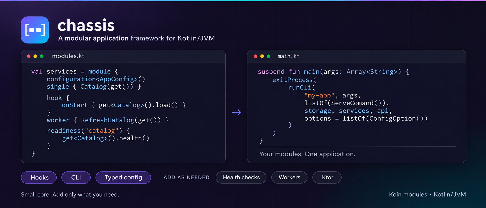

<div align="center">



[](https://central.sonatype.com/artifact/kim.jade/chassis-core)
[](https://kotlinlang.org/)
[](#installation)
[](LICENSE)

</div>

`chassis` is a modular application framework for Kotlin on the JVM. Build an application by composing
[Koin](https://insert-koin.io/) modules that bring together your services, configuration, resource hooks, and
background work. Define each feature in a module, then assemble the modules your application needs.

Hooks, a command line host, and typed, layered configuration provide the building blocks for everyday applications.
Add health checks, workers, or a Ktor server when you need them. The core stays small, and each extension is a
separate dependency you choose to include.

## Contents

- [Modules](#modules)
- [Installation](#installation)
- [Quick start](#quick-start)
- [Lifecycle hooks](#lifecycle-hooks)
- [Workers](#workers)
- [Command line applications](#command-line-applications)
- [Configuration](#configuration)
- [Health checks](#health-checks)
- [Ktor server](#ktor-server)
- [Example](#example)
- [Building](#building)
- [License](#license)

## Modules

| Artifact | Directory | What it adds |
| --- | --- | --- |
| `kim.jade:chassis-core` | `core/` | `Application`, lifecycle hooks, `runApplication` |
| `kim.jade:chassis-worker` | `worker/` | Long-running `Worker`s started and stopped with the application |
| `kim.jade:chassis-cli` | `cli/` | `runCli`: commands that run inside a started application |
| `kim.jade:chassis-config` | `config/` | Typed configuration sections read from layered files (JSON built in) |
| `kim.jade:chassis-config-toml` | `config/toml/` | TOML files for `chassis-config` |
| `kim.jade:chassis-config-yaml` | `config/yaml/` | YAML files for `chassis-config` |
| `kim.jade:chassis-health` | `health/` | Liveness and readiness checks |
| `kim.jade:chassis-ktor` | `ktor/` | A Ktor server opened and closed with the application |

Every module depends on `chassis-core`. Nothing else is pulled in unless you ask for it.

## Installation

`chassis` needs Java 17 or later.

```kotlin
dependencies {
    implementation("kim.jade:chassis-core:<version>")

    // Add what you use.
    implementation("kim.jade:chassis-worker:<version>")
    implementation("kim.jade:chassis-cli:<version>")
    implementation("kim.jade:chassis-config:<version>") //json
    implementation("kim.jade:chassis-config-toml:<version>")
    implementation("kim.jade:chassis-health:<version>")
    implementation("kim.jade:chassis-ktor:<version>")
}
```

`chassis` logs through [kotlinx-logger](https://github.com/jdekim43/kotlinx-logger). `chassis-core` also brings
`kotlinx-logger-integration-jvm`, which routes SLF4J and `java.util.logging` to the same logger, so libraries such as
Ktor log to the same place. If your application already has an SLF4J provider such as Logback, exclude one of the
two.

## Quick start

```kotlin
import kim.jade.chassis.hook.onInitialize
import kim.jade.chassis.hook.onRelease
import kim.jade.chassis.runApplication
import org.koin.dsl.module

val storage = module {
    single(createdAtStart = true) {
        Database(url = "jdbc:…").also {
            onInitialize { it.connect() }
            onRelease { it.close() }
        }
    }
}

suspend fun main() = runApplication(storage)
```

`runApplication` starts the application, keeps the process up, and runs the shutdown when the process receives
SIGTERM or SIGINT or when the calling coroutine is cancelled.

To drive the lifecycle yourself, use `Application` directly:

```kotlin
val application = Application(storage)
application.start()             // returns once the application is ACTIVE
application.stop()              // runs the shutdown and waits for it
```

## Lifecycle hooks

A hook is a block that runs in one phase of the lifecycle.

| Phase | DSL | Use it for | Order |
| --- | --- | --- | --- |
| `Initialize` | `onInitialize` | Acquiring resources: opening connections, running migrations | Registration order |
| `Start` | `onStart` | Getting ready to work: warming caches, subscribing | Registration order |
| `Started` | `onStarted` | Work that begins once the application is `ACTIVE` | Registration order |
| `RequestStop` | `onRequestStop` | Announcing the stop. Signal only, do not wait | Reverse order |
| `Stop` | `onStop` | Ending the work | Reverse order |
| `Release` | `onRelease` | Releasing resources | Reverse order |

Hooks are declared next to the object they belong to, or at module level:

```kotlin
val storage = module {
    // Attached to an object
    single(createdAtStart = true) {
        Catalog(get()).also {
            onInitialize { it.open() }
            onRelease { it.close() }
        }
    }

    // Module level, with access to Koin
    hook {
        val migrator = get<Migrator>()
        onInitialize { migrator.migrate() }
    }

    // Module level, without dependencies
    onStarted { println("ready") }
}
```

- A hook is registered after the hooks of everything it resolved with `get()`, so dependencies start first and stop
  last.
- Hooks can only be registered while the application starts. A definition that registers hooks must be created
  then: declare it with `createdAtStart = true` or resolve it inside `hook { }`.
- A failing `Initialize` or `Start` hook fails the start. Stop hooks always run, even after a failed start, and one
  failing stop hook does not skip the others. The application ends as `FAILED` if anything failed.
- The three stop phases share one time limit, `Application(shutdownTimeout = 30.seconds)`.

## Workers

A worker is a long-running task. It starts when the application becomes `ACTIVE` and is asked to stop when the
application stops.

```kotlin
class Poller(private val queue: Queue) : Worker {
    private val stopped = CompletableDeferred<Unit>()

    override suspend fun run() {
        while (!stopped.isCompleted) {
            queue.poll()?.let { handle(it) }
            withTimeoutOrNull(1.seconds) { stopped.await() }
        }
    }

    override fun onRequestStop() {
        stopped.complete(Unit)
    }
}

val polling = module {
    worker { Poller(get()) }
}
```

- A worker that fails stops the application with that failure.
- On stop, workers get `onRequestStop()` and then `WorkerOptions.graceful` (10 seconds by default) to finish.
  Workers still running after that are cancelled.

## Command line applications

`runCli` runs [Clikt](https://ajalt.github.io/clikt/) commands inside a started application and returns the exit
code.

```kotlin
class ListCommand : ApplicationCommand("list") {
    override suspend fun run(application: Application) {
        application.koin.get<CatalogStore>().names.forEach { echo(it) }
    }
}

suspend fun main(arguments: Array<String>) {
    exitProcess(runCli("catalog", arguments, listOf(ListCommand()), catalogModule))
}
```

- The application starts before the command runs and stops after it returns. A long-running command such as
  `serve` simply waits with `awaitCancellation()`.
- Every command loads the same modules. A module that should only act for one command checks
  `application.attributes[RunningCommand]`.
- `--log=stdout|stderr|<file>` chooses where logs go. Without it only errors are written, to stderr.
- A failure is logged, the last line on stderr is `Error: …`, and the exit code is 1.

## Configuration

A configuration class is bound to a section of the configuration files and resolved when the application starts.

```kotlin
@Configuration("server")
data class ServerConfig(
    val host: String = "127.0.0.1",
    val port: Int = 8080,
    val timeout: Duration = 30.seconds,
) : ValidatableConfiguration {
    override fun validate(): List<ConfigurationIssue> =
        if (port in 0..65535) emptyList() else listOf(ConfigurationIssue("port", "OUT_OF_RANGE"))
}

val server = module {
    configuration<ServerConfig>()
    single { Server(get<ServerConfig>()) }
}
```

```toml
[server]
port = 9090
timeout = "45s"
```

- Configuration classes use `kotlinx.serialization`, so the module needs the `kotlin("plugin.serialization")`
  Gradle plugin. `@Configuration` already makes the class serializable.
- With `chassis-cli`, pass `ConfigOption()` to `runCli` and give files with `--config <file>`. Repeat the option to
  layer files; a later file overrides an earlier one key by key.
- Without the CLI, add files before starting:
  `application.configurations.add(ConfigurationDocument.load(file))`.
- JSON is read by `chassis-config` itself. Add `chassis-config-toml` or `chassis-config-yaml` to read those formats;
  the format is chosen by file extension.
- Reading is strict. A missing required key, an unknown key or a value of the wrong type fails the start. The
  message names the file and the key, not the value.
- Durations are written as `"30s"`, `"500ms"`, `"1m 30s"` or in ISO form (`"PT30S"`).

## Health checks

```kotlin
val storage = module {
    single { Database(get()) }

    readiness("storage") {
        if (get<Database>().ping()) Health.healthy() else Health.unhealthy("no connection")
    }
}

val report = application.checkReadiness()
// HealthReport(status = ACTIVE, healthy = false, checks = [HealthCheckResult("storage", false, "no connection")])
```

- `liveness` answers "is the process alive", `readiness` answers "can it take work now".
- Checks run only while the application is `ACTIVE`. While it starts or stops it is alive but not ready.
- A check that throws is reported as unhealthy and the remaining checks still run.

## Ktor server

`chassis-ktor` opens a [Ktor](https://ktor.io/) server from the application and closes it in the `Stop` phase. It
waits for requests in flight, up to the engine's shutdown grace period, and closes before resources are released.

```kotlin
val http = module {
    ktorServer(CIO, autoStart = true) { engine ->
        val config = get<ServerConfig>()
        engine.connector {
            host = config.host
            port = config.port
        }
    }
    healthEndpoints()               // GET /health/live and /health/ready
}

val catalog = module {
    single { CatalogStore(get()) }

    ktor { server ->
        val store = get<CatalogStore>()
        server.routing {
            get("/products") { call.respondText(store.names.joinToString("\n")) }
        }
    }
}
```

- Feature modules contribute routes and plugins with `ktor { }`. The blocks run when the server starts. An object
  that registers lifecycle hooks cannot be created for the first time inside a block; create it at startup.
- `autoStart = true` opens the server in the `Start` phase. Leave it off in a CLI application, where every command
  loads every module, and call `KtorServer.start()` from the command that serves:

  ```kotlin
  class ServeCommand : ApplicationCommand("serve") {
      override suspend fun run(application: Application) {
          val server = application.koin.get<KtorServer>()
          server.start()
          echo("Serving on ${server.addresses().joinToString()}")
          awaitCancellation()
      }
  }
  ```

- The engine is yours to choose (`ktor-server-cio`, `ktor-server-netty`, …), and so is everything in the engine
  configuration, including how long shutdown waits (`shutdownGracePeriod`, `shutdownTimeout`).
- The health endpoints answer 200 when healthy and 503 otherwise, with one line per check.

## Example

[`examples/catalog`](examples/catalog) puts configuration, the CLI, workers, health checks and the Ktor server
together in one small application.

```bash
./gradlew -q :examples:catalog:run --args="--config config/application.toml list"
```

```bash
./gradlew -q :examples:catalog:run --args="--config config/application.toml --log stdout serve"
```

## License

[Apache License 2.0](LICENSE)
